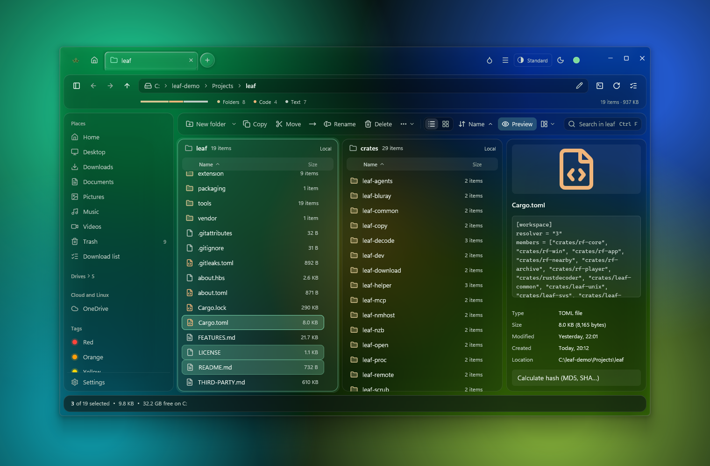
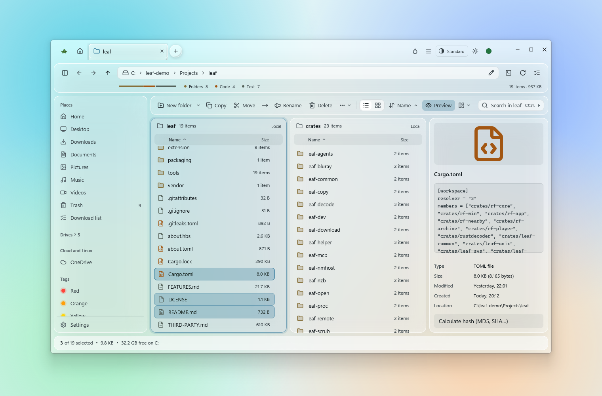
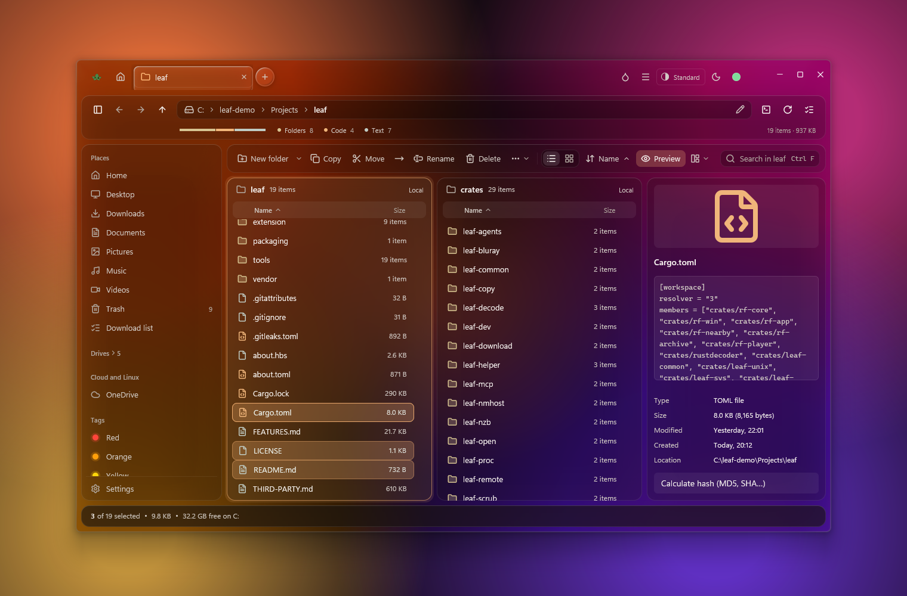

<div align="center">


# leaf

**A fast, keyboard-friendly file manager for Windows 11 and Linux, written in Rust.**

Tabs and split panes, archives and servers that open like folders, a preview for almost every file,
and the tools you would otherwise install five other programs for.

[](https://github.com/nomfpv/leaf-filemanager/actions/workflows/ci.yml)
[](LICENSE)



</div>

## Why leaf

- **It stays out of your way.** leaf is built to open very large folders quickly and to stay light on memory. Long jobs
  (copies, downloads, syncs) run in the Status Center while you keep working.
- **Everything is a command.** Every action has a name, most have a shortcut, and the command palette (`Ctrl+Shift+P`) finds any
  of them from a few letters. The full list is in [FEATURES.md](FEATURES.md).
- **One window for local and remote.** A zip file, an SFTP server, a Docker container and a folder on your disk all open the same
  way, in the same panes.
- **Careful with your files.** Deletes go to the Trash (on servers too), copy, move, rename and delete can be undone, and tools
  that change files show what they would do before they do it.
- **Quiet by default.** leaf does not check for updates unless you turn that on and give it an address; it ships with none.

## What it does

### Browsing

- Tabs, several windows, and panes split side by side or top and bottom
- Five views: details, grid, columns, cards and a compact list
- A preview pane, and a full viewer on `Space` for pictures, video, PDF, text and code, Markdown, CSV, archives, fonts,
  e-mail and documents; camera RAW files are developed in the background
- Search by name, search inside file contents (plain text or regular expression), and a history of the folders you visited
- Folder aliases (`@name` in the address bar), tags, a shelf to park files on, saved sessions
- Zip, 7z, RAR and tar archives open like folders, and zip, 7z and tar can be made; disc images (`.iso`, `.img`) mount read-only

### Files

- Copy, move, rename, duplicate and delete with undo and redo
- Compare two folders, find duplicate files, find build junk (`node_modules`, `target`, `.venv` ...) and see what it weighs
- Checkpoints: save how a folder is now and put it back later with one restore
- Remove metadata from pictures, PDFs, Office and OpenDocument files, music and video (EXIF, GPS, authors, thumbnails and
  more), with every result checked after it is written
- Turn an unprotected Blu-ray, AVCHD card or `.m2ts` files into one MKV without losing quality (copy-protected discs are not
  converted)

### Servers and other devices

- SFTP, FTP, FTPS, WebDAV and SMB hosts in the sidebar; passwords can be kept in the system keyring
- Copy straight from one server to another, edit a remote file in place, follow a growing log file
- Sync jobs (mirror, backup, two-way) between folders or with a server, each with a preview before anything is copied
- Share a folder with a friend who runs leaf too, with no server in between
- Send files to a phone or computer nearby: leaf speaks LocalSend

### Downloads

- Download a web address into the current folder: several connections at once, resumed after a cut line or a restart
- One list for every download: web addresses, videos, Usenet (NZB, checked and repaired with par2) and the browser's own
- A [browser extension](extension/README.md) for Chrome, Edge, Brave and Firefox hands downloads over to leaf
- An optional VPN (Mullvad) that only leaf's own connections use; nothing else on the PC changes

### For developers

- Git: changed files with their differences in the preview pane, a review page to stage, revert and commit, and worktrees by
  branch
- Hide git-ignored files, copy a path relative to the repository, open the folder in your terminal or editor
- Docker containers listed as folders, with their mounts and volumes
- A [command line](docs/cli.md): `leaf <folder>`, `leaf reveal <file>`, `leaf download <address>`

### For work with coding agents

- Copy files or a whole folder as one text block for a chat, with a token estimate; collect files in named context baskets
- See the Claude Code sessions that are running, by project, and what an agent reads in a project (the "project brain")
- Lanes: one worktree and branch per piece of work, with an agent started in it, reviewed and merged from leaf
- Protect files from agents, or allow them, by writing the permission rules for you (shown first)
- [leaf-mcp](docs/mcp.md): an MCP server through which an assistant can show, pick, search and list files in the running leaf.
  Moving and deleting through it is off by default and limited to the project folder.

### Making it yours

- Three themes, each dark and light: **Canopy** (frosted glass), **Stem** (calm and solid) and **Index** (dense, ruled rows)
- Accent colours per theme, and a choice of window backdrops. **HyperGlass** (experimental) frosts and bends whatever is
  behind the window; it is the backdrop in the pictures on this page.
- [Your own theme](docs/themes.md) is one TOML file; [icon packs](docs/icon-packs.md) replace the file and folder icons
- A Home page of widgets you can add, remove, resize and reorder
- An [extension seam](docs/extensions.md) for add-ons that live in their own crate

| Canopy, light, Lagoon accent | Canopy, dark, Sunset accent |
|---|---|
|  |  |

## A few shortcuts

| | |
|---|---|
| Command palette | `Ctrl+Shift+P` |
| Guide ("How do I ...") | `F1` |
| New tab / close tab | `Ctrl+T` / `Ctrl+W` |
| Two panes | `Ctrl+Shift+D` |
| Copy / move to the other pane | `Shift+F5` / `Shift+F6` |
| Preview pane / viewer | `Alt+P` / `Space` |
| Address bar | `Ctrl+L` |
| Past folders | `Ctrl+P` |
| Terminal here | `` Ctrl+Shift+` `` |

Every command and shortcut: [FEATURES.md](FEATURES.md), or Settings > What leaf can do.

## Status

leaf is young and moves fast.

- **Windows 11** is the main platform and works today.
- **Linux (KDE)** is in progress; the aim is the same features on both.
- There are **no ready-made downloads yet**, so for now you build it yourself (below).

## Build

You need a recent stable [Rust](https://rustup.rs) toolchain. On Windows also the Visual Studio C++ build tools.

```
git clone https://github.com/nomfpv/leaf-filemanager
cd leaf-filemanager
cargo build --release -p rf-app
```

The program is `target/release/leaf.exe` (`leaf` on Linux). To run the tests:

```
cargo test -p rf-core -p rf-app
```

### Install on Windows

```powershell
tools\package.ps1         # release build, staged in dist\stage
tools\install-local.ps1   # copies it to %LOCALAPPDATA%\Programs\leaf and adds a Start menu shortcut
```

Installing for all users, making a setup program and how updates work are described in [docs/packaging.md](docs/packaging.md).

### Install on Arch Linux

`packaging/linux/PKGBUILD` builds leaf from this repository:

```
cd packaging/linux && makepkg -si
```

## Documentation

| | |
|---|---|
| [FEATURES.md](FEATURES.md) | every command, what it does and its shortcut |
| [docs/cli.md](docs/cli.md) | leaf on the command line |
| [docs/themes.md](docs/themes.md) | the themes and how to write your own |
| [docs/icon-packs.md](docs/icon-packs.md) | your own file and folder icons |
| [docs/mcp.md](docs/mcp.md) | leaf for AI assistants |
| [docs/extensions.md](docs/extensions.md) | writing an extension |
| [docs/packaging.md](docs/packaging.md) | packaging, installing and updates on Windows |
| [extension/README.md](extension/README.md) | the browser extension |

Inside leaf, `F1` opens a searchable guide of short how-to steps.

## Contributing

Bug reports and ideas are welcome in the [issues](https://github.com/nomfpv/leaf-filemanager/issues). For a bug, say what you
did, what you expected and what happened, with your system and leaf's version (Settings > About).

## Credits

leaf is a fork of [rustyfiles](https://github.com/gelenmedya/rustyfiles) by Özer Güzel (MIT), and is built on
[GPUI](https://www.gpui.rs). The licences of everything leaf is built on, and of the bundled icons, are listed in
[THIRD-PARTY.md](THIRD-PARTY.md); regenerate it with `tools\third-party.ps1`.

## Licence

MIT, see [LICENSE](LICENSE).
